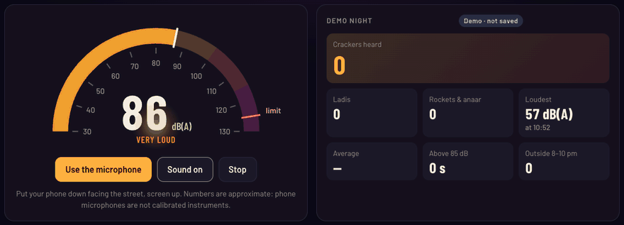
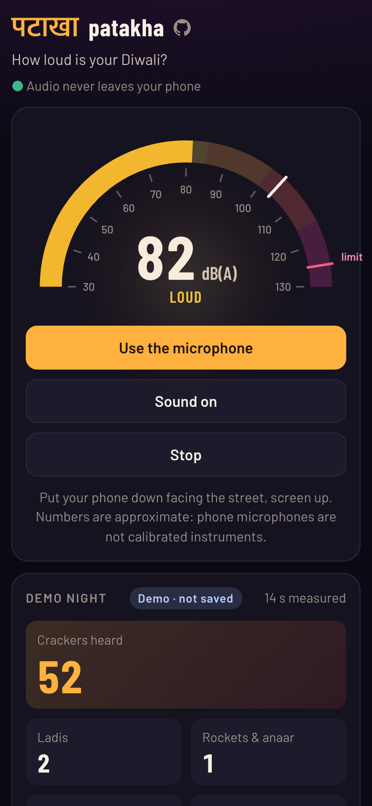

# patakha · पटाखा

[](https://samarthjaiswal.github.io/patakha/)
[](https://github.com/SAMARTHJAISWAL/patakha/actions/workflows/ci.yml)

**How loud is your Diwali?** patakha turns your phone into a firecracker noise meter. Put it down facing the street and it shows the sound level live, draws a spectrogram, and detects every cracker as it goes off, telling single bangs, *ladi* chains and rockets or *anaar* fountains apart. By the end of the night you know how many crackers went off, the loudest moment, how long the street was above harmful levels, and how many went off outside the 8–10 pm window.

Everything runs on your phone. Audio is analysed as it arrives and never recorded, stored or sent anywhere.

**[Open the meter →](https://samarthjaiswal.github.io/patakha/)** No microphone to hand? Press **Play the demo night**. It has its own count, marked as a demo and never saved, so it can't mix with a real night.




## What it measures

| Number | What it is |
| --- | --- |
| **Live level** | A-weighted, Fast time weighting (LAF), as a sound level meter shows it. The gauge marks the 125 dB limit for crackers and the loudest moment so far. |
| **Crackers heard** | Every detected bang; a ladi counts each bang in it. |
| **Ladis** | Strings of five or more bangs in quick succession. |
| **Rockets & anaar** | Sounds that stay near their loudest for half a second or more: rocket whistles, anaar fountains, chakri. |
| **Loudest** | The highest Fast level, and when it happened. |
| **Average** | The energy average over the whole night (LAeq), the number noise rules use. |
| **Above 85 dB** | Time spent above the level where hours a day start to damage hearing. |
| **Outside 8–10 pm** | Crackers heard outside the window the Supreme Court set for Diwali in 2018. |

Below the numbers:
- **The last 90 seconds** as a level chart, with a mark for every bang.
- **A live spectrogram.** A bang is a bright vertical streak; a rocket's whistle is a rising line.
- **Every burst, newest first,** with its time, kind and peak level. The list downloads as CSV.

The night's count survives a reload. The screen stays awake while measuring, where the browser allows it.

<p align="center"></p>

## How it works

```
microphone ─┬─▶ AudioWorklet: A-weighting filter ─▶ 10 ms blocks ─▶ meter ─▶ gauge, totals
(or demo)   │                                                    └─▶ burst detector ─▶ log
            └─▶ AnalyserNode (FFT) ─▶ spectrogram
```

**Opening the microphone.** It is opened with echo cancellation, noise suppression and automatic gain control all turned off. Those are built for calls, and each one quietly distorts a level reading: gain control alone would flatten every bang.

**A-weighting.** Sound level meters weight frequencies roughly the way hearing does (IEC 61672-1): low rumble counts for much less than the 1–4 kHz range. patakha implements the standard analogue A-weighting curve as a digital filter:
- **Filter:** the curve's four zeros at the origin and poles at 20.6 Hz (two), 107.7 Hz, 737.9 Hz and 12,194 Hz (two) are mapped to the sample rate with the bilinear transform.
- **Structure:** it is split into three second-order sections and normalised to exactly 0 dB at 1 kHz.
- **Accuracy:** at 48 kHz it matches the IEC table within 0.15 dB from 31.5 Hz to 4 kHz, and stays inside the class 1 tolerances above that.

**Blocks and the meter.** The filter runs in an AudioWorklet on the audio thread. That thread sends the page a 10 ms block at a time: the A-weighted mean square, the largest sample and whether the microphone overloaded. The meter keeps three levels:
- Fast (125 ms) and Slow (1 s) levels, using the standard exponential time weightings;
- the energy average (LAeq);
- the time above 85 and 100 dB.

**Finding crackers.** A cracker is an impulse: the level jumps by tens of decibels within a few milliseconds, then decays. The detector works like this:
- **Background:** it estimates the background as the 30th percentile of the last 5 seconds, so the bursts themselves barely move it.
- **New bang:** it starts one when the level rises at least 9 dB within 30 ms *and* ends up at least 14 dB above the background.
- **Bangs that overlap:** in a ladi the next bang often rises only a few decibels out of the previous one's echo. Inside an event, a dip of 6 dB followed by a sharp 6 dB rise within 20 ms starts a new bang.
- **Ladi:** five or more bangs whose *starts* are less than 0.45 s apart. Starts, not ends, because a big bomb's echo can run for a second into the next sound.
- **Long sound:** one that stays within 10 dB of its loudest point for at least half a second (rockets, anaar). Total duration would not do, for the same reason.
- **Background changes:** something that jumps up and *stays* loud for 8 seconds is not a cracker but a change in the background, such as a generator starting or music. That event is dropped and the background re-learned.
- **Restarts:** each time listening starts, the detector re-learns the background from scratch, because the phone may be somewhere else now.

Detection works on levels relative to full scale, so calibration doesn't change what counts as a cracker. Levels are stored uncalibrated too, so recalibrating moves every number together.

### How accurate is it?

**Counting** is the strong part, because it only needs *differences* in level, and those are reliable even on an uncalibrated microphone. On synthesised nights the counts were near-perfect (see the Testing section). Real streets are messier: overlapping crackers from many directions, echoes between buildings and vehicles passing. Expect counts in the right range rather than exact ones.

**Absolute decibels** are approximate. A phone reports levels relative to digital full scale, not sound pressure. patakha assumes a typical phone sensitivity (0 dBFS ≈ 120 dB), but real phones differ by several decibels, and their microphones overload well below the loudest crackers. When that happens the reading is marked with a `+`, meaning it was louder than shown. If you have a real sound level meter, use **Calibrate** to match it.

## The rules it refers to

- **The noise limit.** Firecrackers must not exceed **125 dB(AI)** (or 145 dB(C) peak) measured 4 metres from where they burst. This is set by the Environment (Protection) Rules, 1986, as amended in 1999.
  - A phone across the street isn't 4 metres away, and it measures dB(A) Fast, not dB(AI), so the gauge's mark is a reference, not a verdict on any particular cracker.
- **The time window.** In *Arjun Gopal v. Union of India* (2018) the Supreme Court limited bursting crackers on Diwali to 8–10 pm. Many states have their own, stricter rules.

## Testing

`npm test` runs 30 tests in about a second:

- **A-weighting:** the filter's response at 44.1 and 48 kHz against the IEC 61672 table, and a time-domain check with sine waves through the filter.
- **The detector on synthetic levels:**
  - single bangs at known times;
  - a 24-bang ladi;
  - a rocket whistle;
  - a busy two-minute night;
  - speech, a slow swell and silence, which must *not* count;
  - bangs in a loud background;
  - microphone overload.
- **The whole pipeline on real audio.** The synthesised demo night (scattered bombs, ladis of 12 to 36 bangs, rocket whistles, an anaar hiss) goes through the same filter, blockers and detector the browser uses, fed in 128-sample chunks like an AudioWorklet. Six nights at both sample rates are tested:
  - every planted event must be found as the right kind, close to its time, with no extras;
  - each ladi count must be within 15%.

  Across 40 nights with 838 events, the detector found every event as the right kind with no false alarms, and ladi counts were off by 1.4% on average.
- **Calibration:** a 1 kHz sine reads exactly where the maths says it should.
- **The night's record:**
  - totals survive a reload even past the 5,000-entry log;
  - recalibrating moves the average and the loudest level together;
  - corrupt or impossible saved data is rejected;
  - a generator starting is not a rocket;
  - after a restart the background is learned afresh.

`scripts/e2e.py` (Python Playwright) checks 31 things in a real browser:

- **The demo night:**
  - the gauge, counting, ladi recognition and the burst list;
  - turning on the sound;
  - the demo is marked as one, and stopping it leaves tonight's real count untouched and unsaved.
- **A fake microphone.** Chromium is given a WAV file that the script writes itself, independent of the app's code: a quiet street, five single bangs and a 20-bang ladi at known times.
  - The app must find them all through the real microphone path, and the ladi's count must be within 3.
  - A reload keeps the count, and the CSV has one row per burst in local time.
  - Two starts fired at once still give one audio stream (time advances at the real rate).
  - Closing the reset dialog with Esc keeps the count; confirming clears it.
  - A refused microphone permission produces a helpful message.
- **The page:**
  - the title links to this repo;
  - on a phone there is no sideways scrolling and everything is big enough to tap;
  - calibration works;
  - no console errors.

## Project layout

```
src/
  dsp/            no browser APIs: the maths
    aweight.ts      A-weighting filter design and the streaming filter
    meter.ts        Fast/Slow levels, LAeq, maximum, time above thresholds
    bursts.ts       the burst detector and classifier
  audio/
    blocks.ts       samples → 10 ms blocks (shared by the worklet and the tests)
    worklet.ts      the AudioWorklet
    engine.ts       microphone, demo playback, analyser
    demo.ts         the synthesised demo night, with its list of events
  session.ts      one night: meter + detector + log + saving
  ui/             the page: gauge, charts, spectrogram, controller
tests/            Vitest: A-weighting, detector, the whole pipeline
scripts/          e2e.py and capture.py (Python Playwright)
```

The production bundle is 24 KB of JavaScript (9 KB gzipped) plus a 2 KB worklet, with Barlow and Mukta fonts bundled through Fontsource. It has no runtime dependencies.

## Running locally

Requires Node 22.12 or later.

```sh
npm ci
npm run dev          # http://localhost:5173 (the microphone works on localhost)
npm test
npm run typecheck
npm run build:pages  # dist/, served from /patakha/ (what GitHub Pages gets)
```

End-to-end checks and screenshots use Python Playwright (`pip install playwright pillow && playwright install chromium`):

```sh
npm run build && npx vite preview --port 4173 &
python scripts/e2e.py http://localhost:4173/
python scripts/capture.py http://localhost:4173/
```

Pushing to `main` runs CI (typecheck, tests, both builds) and deploys to GitHub Pages.

## References

- IEC 61672-1:2013, *Electroacoustics: Sound level meters, Part 1: Specifications* (A-weighting, time weightings).
- Environment (Protection) Rules, 1986, Schedule I, as amended by G.S.R. 682(E), 1999: noise standards for firecrackers.
- *Arjun Gopal v. Union of India*, Supreme Court of India, 23 October 2018.
- WHO, *Environmental Noise Guidelines for the European Region*, 2018.

## Licence

[MIT](LICENSE) © 2026 Samarth Jaiswal
